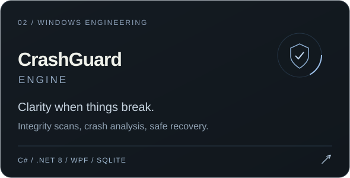

 

Independent developer based in **Türkiye**. I build useful software, thoughtful tools, and games with a little personality.

 

<a href="https://github.com/fkalsasx?tab=repositories">Explore my work ↗</a>&nbsp;&nbsp; · &nbsp;&nbsp;<a href="https://fkalsasx.github.io/traceglass/">Try Traceglass ↗</a>&nbsp;&nbsp; · &nbsp;&nbsp;<a href="mailto:fkalsasx@gmail.com">Get in touch ↗</a>

 

### Selected work

 

 

### Behind the work

| Focus | Toolkit |
| :--- | :--- |
| **Developer tools** | JavaScript · Node.js · Browser APIs |
| **Windows software** | C# · .NET · WPF · SQLite |
| **Games & interaction** | Godot · Puzzle design · UI design |
| **Everyday workflow** | Git · GitHub · PowerShell · VS Code · Visual Studio |

I care about clear interfaces, reliable behavior, and taking an idea all the way to a usable release.

 

